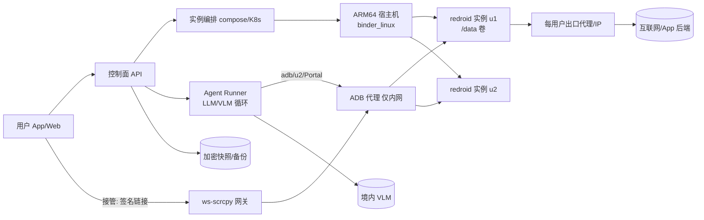

# 基于 Redroid 的 AI Agent 云手机实施方案（2026-10-12）

> 核实标记：✅ = 本次已在线核实（附 URL）；⚠️ = 未核实或凭经验，上线前请自己验证。
> 核心来源：
> - Redroid README：https://github.com/remote-android/redroid-doc （raw/master/README.md）
> - 部署页：https://github.com/remote-android/redroid-doc/tree/master/deploy （ubuntu.md / debian.md / alibaba-cloud-linux.md）
> - 内核模块：https://github.com/remote-android/redroid-modules
> - redroid-script：https://github.com/ayasa520/redroid-script
> - DroidRun（现已更名 Mobilerun）：https://github.com/droidrun/droidrun
> - ws-scrcpy：https://github.com/NetrisTV/ws-scrcpy
> - uiautomator2：https://github.com/openatx/uiautomator2
> - ADBKeyBoard：https://github.com/senzhk/ADBKeyBoard
> - scrcpy：https://github.com/Genymobile/scrcpy

## 0. 本机验证结果
- 本机环境：Debian 13 (trixie)，内核 6.12.94+，x86_64，`systemd-detect-virt` 显示 `container-other`。
- 没有 `/dev/binder*`，`/proc/filesystems` 里没有 binder，`/lib/modules/$(uname -r)` 不存在，也没有 modprobe。也就是说，这台机器本身是一个容器，**没法加载 binder，跑不起 Redroid**，所以 quickstart 没在本机验证。要在真正的 VM 或裸金属上验证（见第 8 节 M0）。

## 1. 宿主机
### 1.1 内核与 binder
- ✅ README 说 Redroid 支持 arm64 和 amd64，"should run on any linux distribution (with some kernel features enabled)"。部署页把 **binderfs** 列为必需内核特性。
- ✅ **Ubuntu 20.04/22.04**：
  ```bash
  apt install linux-modules-extra-`uname -r`
  modprobe binder_linux devices="binder,hwbinder,vndbinder"
  modprobe ashmem_linux   # 可选；5.18 起内核已移除 ashmem
  ```
  Ubuntu 18.04 要先装 HWE 内核（5.0+），再执行 `modprobe nfnetlink`。
- ✅ **Debian 11/12**：`modprobe binder_linux devices=binder1,...,binder6; chmod 666 /dev/binder*`，然后在 docker run 里加 `-v /dev/binder1:/dev/binder -v /dev/binder2:/dev/hwbinder -v /dev/binder3:/dev/vndbinder`。官方建议在内核里开启 `CONFIG_ANDROID_BINDER_IPC=y`、`CONFIG_ANDROID_BINDERFS=y`、`CONFIG_ANDROID_BINDER_DEVICES="binder,hwbinder,vndbinder"`，这样容器数量不受限，也不用逐个挂载设备。
- ✅ **redroid-modules** 支持 4.14+ 内核，有 AmazonLinux2、Alibaba Cloud Linux 2/3、openEuler 20.03 分支，可手动、DKMS、Docker、K8s 安装。"kernel >= 5.7 请用自定义内核或 modprobe（Ubuntu 等）"。
- ⚠️ 不少云厂商的精简内核（如 `linux-aws`/`linux-azure`/`-gcp`，或 GKE COS 这类托管 K8s 节点镜像）可能没编译 binder。先查 `grep BINDER /boot/config-$(uname -r)`，没有就换 generic 内核或自己编译。
- 持久化：在 `/etc/modules-load.d/redroid.conf` 写 `binder_linux`，在 `/etc/modprobe.d/redroid.conf` 写 `options binder_linux devices=binder,hwbinder,vndbinder`（⚠️ 通用 Linux 做法）。
- 推荐：**Ubuntu 22.04/24.04 generic 内核**（⚠️ 24.04 没出现在官方部署页）。

### 1.2 ARM 和 x86 怎么选
- 很多国产 App 只有 ARM 版，**首选 ARM64 宿主机**：原生运行，没有翻译开销，兼容性最好。
- 用 x86 就得靠翻译。✅ README 写明可用 libhoudini、libndk_translation 或 QEMU 翻译，且"Published redroid images already got libndk_translation included"（⚠️ 不清楚 64only 镜像是否也包含，请测）。redroid-script 可以加 libndk（来自 guybrush 固件）或 libhoudini。⚠️ 有加固（梆梆、360、爱加密等）或依赖 NEON/JIT 的 App，在翻译层上常崩溃或被识别为模拟器。
- 机型（⚠️ 规格和价格请以官网为准）：AWS Graviton（c7g/m7g/c8g；裸金属 `*.metal`），阿里云倚天 710（g8y/c8y），华为云鲲鹏（kc1/kc2），Ampere Altra（Oracle A1、Hetzner CAX）。ARM 云主机要确认 Ubuntu 镜像能 `modprobe binder_linux`。⚠️ 有些 ARM 内核的页大小是 64K（如部分 openEuler/CentOS），Android 需要 4K 页，要选 4K 页内核。

## 2. Redroid 镜像
### 2.1 版本和 tag ✅
`redroid/redroid:{8.1.0,9.0.0,10.0.0,11.0.0,12.0.0,13.0.0,14.0.0,15.0.0,16.0.0}-latest`；12 到 16 另有 `_64only-latest`。镜像是多架构的（amd64/arm64）。
建议：国产 App 用 **12.0.0 或 13.0.0（带 32 位）**，因为部分 App 还带 32 位 so；64only 更省内存，但老 App 可能装不上（⚠️）。

### 2.2 启动参数 ✅（README 配置表）
| 参数 | 说明 | 默认 |
|---|---|---|
| androidboot.redroid_width / height | 分辨率 | 720 / 1280 |
| androidboot.redroid_dpi | DPI | 320 |
| androidboot.redroid_fps | 帧率 | 开 GPU 30，不开 15 |
| androidboot.redroid_gpu_mode | auto/host/guest（guest 即软件渲染） | guest |
| androidboot.redroid_gpu_node | GPU 节点 | 自动检测 |
| androidboot.use_memfd | 用 memfd 代替 ashmem | false |
| androidboot.use_redroid_overlayfs | /data-base 共享，/data-diff 私有 | 0 |
| androidboot.redroid_net_ndns / dns1..N | DNS（不配则用 8.8.8.8） | 0 |
| androidboot.redroid_net_proxy_type/host/port/exclude_list/pac | 系统代理（static/pac/none） | 端口 3128 |
| ro.xxx | 调试用，覆盖 ro 属性（如 ro.secure=0 拿 root adb） | |

国内必须设置 DNS，比如 `androidboot.redroid_net_ndns=1 androidboot.redroid_net_dns1=223.5.5.5`，因为默认的 8.8.8.8 在国内经常不通。

### 2.3 GPU
- ✅ 模式有 host、guest、auto，guest 是软件渲染。
- ⚠️ host 模式依赖宿主机 Mesa DRM 驱动（Intel/AMD 走 `/dev/dri/renderD*`）；**NVIDIA 闭源驱动一般不支持**。不用 GPU 时，Agent 截图场景下软件渲染够用，代价是 CPU 占用高一些。ARM 云主机通常没有 GPU，直接用 guest。
- virgl 是 QEMU/VM 的方案，Redroid 容器不用（⚠️）。

### 2.4 GMS、root 和自定义镜像
- ✅ 官方提到 GMS 可以走 OpenGApps、MicroG 或 MindTheGapps，构建见 `android-builder-docker`（AOSP 构建流程）。
- ✅ redroid-script（`python redroid.py -a 11.0.0 -mtg/-g/-lg/-n/-m/-w …`）可以不重新编译，直接给镜像加 Gapps、Magisk、libndk/libhoudini、Widevine。其 README 写明 Magisk Delta 已不可用（被划掉），改用官方 Magisk。
- 国产 App 基本不需要 GMS，**建议默认不装**，省资源也少一个检测特征。
- 自定义镜像：`FROM redroid/redroid:12.0.0-latest`，再 `ADD`/`COPY` 预装 APK（放到 /system/priv-app 或首次启动时用 adb install）、修改 build.prop。
- 隐藏 root：可用 Magisk 的 Zygisk、DenyList、Shamiko。⚠️ 但容器本身特征明显（第 6 节），能隐藏的程度有限。

## 3. 多实例编排
```yaml
# docker-compose.yml（示例；data 目录按用户隔离）
services:
  phone-u1:
    image: redroid/redroid:12.0.0-latest
    privileged: true
    volumes: ["/srv/redroid/u1:/data"]
    ports: ["127.0.0.1:5601:5555"]     # 只监听 127.0.0.1，绝不能暴露到公网
    mem_limit: 3g
    cpus: 2
    command:
      - androidboot.redroid_width=720
      - androidboot.redroid_height=1280
      - androidboot.redroid_dpi=320
      - androidboot.redroid_fps=15
      - androidboot.redroid_net_ndns=1
      - androidboot.redroid_net_dns1=223.5.5.5
      - androidboot.use_memfd=true
```
- 持久化：每个用户一个 `/data` 目录（建议 btrfs/ZFS 子卷或 LVM thin，方便快照）。✅ `use_redroid_overlayfs` 可以让多个实例共享基础 data 层，节省磁盘。
- 快照和备份：先停容器（或 `adb shell sync`），再做 btrfs snapshot 或 tar；迁移就是拷贝 data 目录。⚠️ 运行中直接快照可能导致 SQLite 损坏。
- 密度（⚠️ 凭经验）：每实例空闲 1–1.5 GB 内存，跑重型国产 App 要 2–4 GB；每实例 1–2 vCPU。按 16C/64G 主机算，约 10–20 个活跃实例。未使用的实例可以 `docker stop` 后按需冷启动（约 10–30 秒）。
- K8s：✅ redroid-modules 提供 K8s 部署方式。Pod 需要 privileged，节点要有 binder；建议一个 Pod 一个实例，配 StatefulSet + PVC。
- 网络和出口 IP：可以用 ✅ `redroid_net_proxy_*` 设系统代理（部分 App 不走系统代理）；更稳妥的是每实例一个独立 docker network，再用 iptables/tproxy 或 sing-box/redsocks 做透明代理，把每个用户绑定到固定出口 IP。
- 隔离：privileged 容器 ≈ 宿主机 root，**多租户不能只靠容器隔离**。建议：一个用户一台轻量 VM（Firecracker/Kata 是否可行 ⚠️，要求 guest 内核带 binder），或者至少一台宿主机只放一个信任域。

## 4. 控制与串流
- ADB：`adb connect 127.0.0.1:5601`。✅ README 明确警告不要把 adb 端口暴露到公网。
- scrcpy：✅ `scrcpy -s host:port`，H.264，局域网延迟约 35–70 ms（⚠️ scrcpy 官方的说法）。适合运维调试。
- ws-scrcpy：✅ 网页客户端（基于 scrcpy server，通过 WebSocket 传 H.264，可用 MSE/Broadway/TinyH264/WebCodecs 解码），支持 Android 5.0+，需开启 adb 调试。适合给最终用户在网页上"接管"。延迟约 100–300 ms（⚠️）。
- WebRTC：✅ Redroid 官方只说"计划"移植 cuttlefish 的 WebRTC，**目前没有现成实现**。备选：自建 scrcpy 转 WebRTC 的网关（Pion/GStreamer webrtcbin），延迟可做到 100 ms 以内（⚠️）。
- 用户接管流程（二维码、验证码、滑块）：Agent 检测到登录页或验证码（VLM 判断或 UI 树里有关键字），把任务状态置为 `NEED_HUMAN`，推送一个带签名、时限 5 分钟的 ws-scrcpy 链接给用户。用户可以远程操作，或者用手机扫描云手机屏幕上显示的二维码（要用另一台设备扫）。完成后用户点"交还"，Agent 继续。要录屏留审计记录，接管期间 Agent 暂停输入。

## 5. Agent 层
- 观测：
  - 截图：`adb exec-out screencap -p`（约 200–500 ms），或 scrcpy 视频流抽帧。
  - UI 树：`adb shell uiautomator dump /sdcard/x.xml`（慢，约 1–3 秒，遇到动画会失败）。✅ uiautomator2 是 Python 库（`pip install uiautomator2`；`u2.connect('127.0.0.1:5601')`、`d.dump_hierarchy()`、`d.screenshot()`、`d(text='同意').click()`），更快更稳。
  - ✅ DroidRun/Mobilerun Portal：基于无障碍服务的 App，提供 UI 树、截图、输入、手势；支持 `--vision`，以及 `--vision-only`（App 没有无障碍信息时纯靠截图）。注意：项目已更名 **Mobilerun**，安装命令是 `uv pip install mobilerun`。
  - 微信、部分游戏和 Flutter/WebView 的 UI 树不完整，需要回退到纯视觉（VLM 坐标定位）。
- 动作空间：tap(x,y)/tap(element_id)、long_press、swipe、type(text)、key(BACK/HOME/ENTER)、launch(pkg)、wait、screenshot、ask_human、done。
- 中文输入：✅ ADBKeyBoard：`adb shell ime set com.android.adbkeyboard/.AdbIME`；`adb shell am broadcast -a ADB_INPUT_B64 --es msg $(echo -n '你好' | base64)`。`adb shell input text` 不支持中文。uiautomator2 自带 `send_keys` 的输入法方案（⚠️）。
- 装 App：从官网或应用商店直链下载 APK（豌豆荚、酷安、官网），校验签名（`apksigner verify --print-certs`）后执行 `adb install -r -g`（-g 自动授予运行时权限）。分包 App 用 `adb install-multiple`。
- 弹窗和权限：`-g` 预授权；uiautomator2 watcher 自动点击"同意/允许/跳过/以后再说"；用 `appops`/`pm grant` 预设权限；通过 `settings put` 关闭系统更新提示等。
- 开源框架（⚠️ 下面这些链接本次未逐一抓取）：
  - DroidRun/Mobilerun https://github.com/droidrun/droidrun ✅
  - Mobile-Agent（阿里 X-PLUG）https://github.com/X-PLUG/MobileAgent
  - AppAgent（腾讯）https://github.com/TencentQQGYLab/AppAgent
  - mobile-use（Minitap）https://github.com/minitap-ai/mobile-use
  - AutoGLM / Open-AutoGLM（智谱）https://github.com/zai-org/Open-AutoGLM
  - UI-TARS（字节）https://github.com/bytedance/UI-TARS
- 建议：先用 DroidRun/Mobilerun 或自研的轻量 loop（uiautomator2 + VLM）做 MVP。

## 6. 反检测与兼容性（⚠️ 本节都是经验判断，未逐条核实）
- 常见检测信号：`ro.product.*`/`ro.hardware`（redroid 字样）、`ro.kernel.qemu`、/proc/cpuinfo、/proc/self/cgroup（docker）、mountinfo（overlay）、缺少基带/IMEI/SIM、传感器（无加速度计、陀螺仪）、电池恒定、无蓝牙/NFC、eth0 网卡、GPU 渲染器名（SwiftShader/llvmpipe）、x86 翻译库（libhoudini/libnb）、su/Magisk、adb 已开、无障碍服务已开、ro.debuggable/ro.secure。
- 能缓解的：用 ✅ `ro.xxx` 启动参数覆盖设备型号、品牌、指纹；ARM 原生运行（避开翻译库特征）；Magisk 配合隐藏模块；关闭开发者选项（但会影响 ADB）。
- 很难做到的：Play Integrity 的 DEVICE/STRONG 级别在 Redroid 上基本过不了，没有硬件密钥证明；银行、支付类 App 和部分加固 App 会直接闪退或拒绝登录；微信、支付宝有风控（异常设备、异地 IP 会触发验证，甚至封号）。
- 现实预期：内容类、电商浏览、工具类 App 大多能用；社交、支付、银行类风险较高，要做好真机回退（USB 真机集群 + 同一套 ADB 接口）的准备。

## 7. 安全与合规（⚠️ 不是法律意见）
- 隔离：privileged 容器等于宿主机 root。要做到：每租户一台 VM 或独立宿主机；ADB 只监听 127.0.0.1，由控制面代理访问；镜像只读，/data 加密（LUKS）；记录审计日志。
- 凭据：不存用户密码，优先让用户亲自接管登录，只保留 App 内会话（data 目录加密存放）；LLM 收到的截图要脱敏（支付页、验证码），或在本地完成识别。
- 服务条款：多数 App（微信、淘宝等）的用户协议禁止自动化、外挂、模拟器，有封号风险。要明确告知用户，并由用户自己授权、自担风险。
- 中国监管：《个人信息保护法》（告知同意、最小必要）、《数据安全法》、《网络安全法》（等保）、《生成式人工智能服务管理暂行办法》（备案）、《互联网信息服务算法推荐管理规定》。境内用户数据要境内存储；如果截图发往境外大模型，涉及数据出境评估，建议用境内备案的模型。另外，自动化"刷量、抢购、爬取"可能违反《反不正当竞争法》或刑法第 285/286 条。

## 8. MVP 实施步骤
### M0（第 1 天）：单机跑通
```bash
# Ubuntu 22.04 ARM64（Graviton/倚天），generic 内核
sudo apt update && sudo apt install -y docker.io adb linux-modules-extra-$(uname -r)
echo binder_linux | sudo tee /etc/modules-load.d/redroid.conf
echo 'options binder_linux devices=binder,hwbinder,vndbinder' | sudo tee /etc/modprobe.d/redroid.conf
sudo modprobe binder_linux devices="binder,hwbinder,vndbinder"
sudo docker run -itd --privileged --name r1 -v /srv/redroid/r1:/data -p 127.0.0.1:5555:5555 \
  redroid/redroid:12.0.0-latest androidboot.redroid_net_ndns=1 androidboot.redroid_net_dns1=223.5.5.5 androidboot.use_memfd=true
adb connect 127.0.0.1:5555 && adb shell getprop sys.boot_completed   # 输出 1 即启动完成
# 出问题时看 dmesg -T，或用官方 debug.sh
```
### M1（第 1 周）：Agent 闭环
安装 ADBKeyBoard、uiautomator2（或 Mobilerun Portal），接入 VLM（如 Qwen-VL、GLM、UI-TARS），完成"打开某 App 搜索商品并返回价格"这类任务。用 10–20 个国产 App 测兼容性，形成兼容矩阵。
### M2（第 2–3 周）：多实例和接管
compose/控制面（FastAPI）负责创建、启停、快照实例；ws-scrcpy 接管链接（经反向代理加鉴权）；每用户独立出口代理。
### M3（第 4–6 周）：生产化
K8s StatefulSet、监控（实例健康、boot_completed）、按需冷启动、加密备份、合规文档、真机回退通道。

### 成本粗估（⚠️ 价格请查官网）
- 阿里云 g8y 16C/64G：约 1500–2500 元/月，可跑 10–20 个活跃实例，平均每实例 100–200 元/月；冷实例只占磁盘，约 1–3 元/月。
- AWS c7g.4xlarge：按需约 0.58 美元/小时（约 420 美元/月）。
- 另计 LLM 调用：每步约 1–2k tokens 加一张图，每个任务 20–50 步，按国产 VLM 价格约 0.05–0.5 元/任务。

### 架构图

